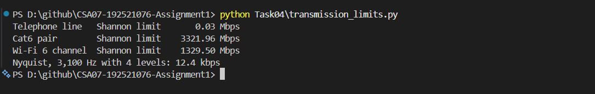

# Task 4 – Choose a Medium for Each Run

## 1. Objective

To select suitable transmission media for different network connections in a manufacturing plant, analyse the effect of electrical noise using Shannon's theorem, and implement Nyquist and Shannon capacity calculations using Python.

## 2. Transmission Medium Selection

| Connection | Distance / Condition | Recommended Medium | Reason |
|---|---|---|---|
| Robot cell to nearby network point | 85 m, near welding machines | Cat6A S/FTP | Shielding helps reduce electromagnetic interference. |
| Office floor to shop-floor switch | 140 m | Multimode fibre | Exceeds the standard 100 m copper Ethernet channel limit. |
| Shop floor to data centre | 550 m | Multimode fibre | Suitable for higher-speed connections over this distance, depending on the fibre and transceiver standard. |
| Plant to head office | 400 km | Single-mode fibre through a leased line | Suitable for long-distance communication with lower attenuation. |

### Copper Ethernet Distance Limitation

A standard copper Ethernet channel is generally limited to 100 metres.

Therefore, the 140 m, 550 m and 400 km connections cannot be implemented as single standard copper Ethernet runs without intermediate equipment or a different medium.

## 3. Shannon Capacity Calculation

Shannon's theorem:

C = B × log₂(1 + SNR)

SNR conversion:

SNR = 10^(SNR in dB / 10)

Given bandwidth = 250 MHz.

### Normal Conditions – 40 dB

SNR = 10^(40/10) = 10,000

C = 250 × 10⁶ × log₂(1 + 10,000)

**Shannon capacity = 3,321.96 Mbps**

### Near Welding Machines – 15 dB

SNR = 10^(15/10) = 31.62

C = 250 × 10⁶ × log₂(1 + 31.62)

**Shannon capacity = 1,256.95 Mbps**

### Comparison

| Condition | SNR | Shannon Capacity |
|---|---:|---:|
| Normal conditions | 40 dB | 3,321.96 Mbps |
| Near welding machines | 15 dB | 1,256.95 Mbps |

The theoretical capacity decreases by approximately 62.16% when the SNR drops from 40 dB to 15 dB.

This demonstrates how electrical noise can reduce the theoretical data-carrying capacity of a communication channel. Shielded cabling or fibre should be considered in electrically noisy environments.

## 4. Why Actual Link Speed Is Below Shannon Capacity

Shannon capacity represents a theoretical upper limit. Actual link speeds are lower because of noise, interference, attenuation, hardware limitations, modulation and coding constraints, and protocol overhead.

## 5. Python Implementation

The Python program implements:

- **Nyquist theorem:** Calculates the maximum bit rate for a noiseless channel.
- **Shannon theorem:** Calculates theoretical channel capacity using bandwidth and SNR.

The SNR value is converted from decibels into a normal ratio before applying Shannon's formula.

**Execution command:**

`python Task04\transmission_limits.py`

### Execution Evidence

## 6. Result

Suitable transmission media were selected for all four network connections based on distance and environmental conditions. Shannon capacity was calculated for normal and electrically noisy conditions. The Python program successfully implemented Nyquist's and Shannon's formulas and produced the expected output.