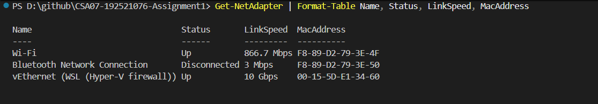

# Task 6 – Interpret an Ethernet Port Report

## 1. Objective

To analyse Ethernet port errors, identify a possible duplex mismatch, recommend the correct configuration, interpret MAC addresses and evaluate jumbo frames and network redundancy.

## 2. Port Report

| Parameter | Value |
|---|---:|
| Speed | 100 Mbps |
| Duplex | Half |
| Auto-negotiation | Off |
| Link detected | Yes |
| RX errors | 2,381 |
| Late collisions | 412 |
| CRC errors | 1,907 |

Late collisions indicate collisions detected outside the normal collision window. CRC errors indicate corrupted Ethernet frames.

The combination suggests a possible duplex mismatch between the PC and the gigabit switch port.

## 3. Corrective Configuration

Enable auto-negotiation on both ends.

Linux:

`sudo ethtool -s eth0 autoneg on`

The switch port must also be configured for auto-negotiation.

## 4. MAC Address Analysis

- `01:00:5e:0a:01:02` is an IPv4 multicast/group MAC address.
- `3c:52:82:4e:11:07` has the OUI `3C:52:82`, which identifies the manufacturer or assignee of the MAC address block.

## 5. Jumbo Frames

Jumbo frames can reduce per-frame overhead and improve bulk CCTV storage transfers. All devices along the communication path must support the configured MTU.

## 6. Ring vs Star

A ring with fast recovery can reroute traffic after a cable cut, depending on its configured protocol. In a star, devices connected through the failed link lose connectivity. A central switch failure can affect the entire star.

Exact recovery times depend on the selected protocols and configurations.

## 7. Practical Evidence

### Windows Ethernet Adapter Information

## 8. Detailed Calculations

Refer to [calculations.md](calculations.md) for the complete error analysis, configuration correction, MAC address interpretation, jumbo-frame evaluation and ring-versus-star comparison.

## 9. Result

The Ethernet report was analysed, a duplex mismatch was identified as the likely cause, and the corrective configuration was determined. MAC addressing, jumbo frames and network redundancy were also evaluated.