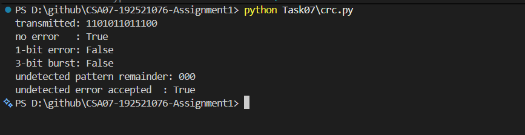

# Task 7 – Will the Receiver Notice the Error?

## 1. Objective

To implement CRC error detection, verify received frames, analyse burst errors, demonstrate two-dimensional parity and calculate the Internet checksum.

## 2. CRC Analysis

Generator = `1011` (x³ + x + 1).

Data = `1101011011`.

After appending three zeros and performing modulo-2 division, the CRC remainder is `100`.

Transmitted frame = `1101011011100`.

The received frame `1101011011101` produces remainder `001`, so it is rejected.

## 3. Burst Error Detection

The generator has degree 3, so all burst errors up to 3 bits are guaranteed to be detected.

An error pattern equal to the generator, `1011`, produces a zero remainder and can therefore go undetected.

## 4. Two-Dimensional Parity

A 4 × 4 data block was selected and even row and column parity bits were calculated.

A rectangular four-bit error affecting R1C1, R1C2, R2C1 and R2C2 is not detected because each affected row and column contains two flipped bits.

## 5. Internet Checksum

The four hexadecimal words are `4500`, `0073`, `0000` and `4000`.

Their sum is `8573`. Taking the one's complement gives the checksum **7A8C**.

## 6. Python Implementation

The program implements modulo-2 XOR division and CRC encoding and checking.

Execution command:

`python Task07\crc.py`

### Execution Evidence

The program successfully generated the expected CRC frame, accepted the error-free frame, rejected the single-bit and three-bit burst-error frames, and demonstrated an undetected error pattern.

## 7. CRC vs Even Parity

CRC-3 detects the tested two-bit error pattern `11`, while even parity misses it. Both methods miss some four-bit error patterns. CRC-3 is stronger for burst-error detection up to three bits, but it is not infallible.

## 8. Detailed Calculations

Refer to [calculations.md](calculations.md) for the complete CRC, parity and Internet checksum working.

## 9. Result

CRC encoding and verification were implemented successfully. The received frame was rejected due to a non-zero remainder. Two-dimensional parity and the Internet checksum were calculated, and CRC was compared with even parity.