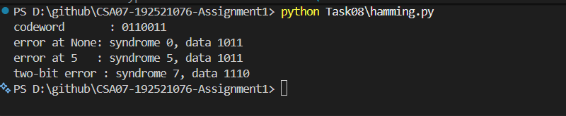

# Task 8 – Correct the Error or Ask Again?

## 1. Objective

To calculate Hamming check bits, determine minimum Hamming distance, correct a corrupted Hamming(7,4) codeword and compare Forward Error Correction (FEC) with Automatic Repeat Request (ARQ).

## 2. Hamming Check Bits

Given data bits = 16.

Using the formula:

2ʳ ≥ m + r + 1

For r = 4:

16 is less than 21, so insufficient.

For r = 5:

32 is greater than or equal to 22.

Therefore, **5 check bits** are required.

Total codeword length = 16 + 5 = **21 bits**.

Overhead relative to original data:

(5 / 16) × 100 = **31.25%**.

## 3. Minimum Hamming Distance

Given codewords:

- 00000
- 01011
- 10101
- 11110

The minimum Hamming distance is **3**.

Maximum detectable errors = 3 − 1 = **2 bits**.

Maximum correctable errors = floor((3 − 1) / 2) = **1 bit**.

Therefore, the code can detect up to two-bit errors and correct one-bit errors.

## 4. Hamming(7,4) Error Correction

Original codeword = `0110011`.

Received codeword = `0110111`.

Syndrome calculations:

- s1 = 1
- s2 = 0
- s3 = 1

Error position:

pos = s1 + 2s2 + 4s3

pos = 1 + 0 + 4 = **5**.

Flip bit 5 from 1 to 0.

Corrected codeword = `0110011`.

Extracting data bits from positions 3, 5, 6 and 7 gives:

**Recovered data = 1011**

## 5. Two-Bit Error Demonstration

Original codeword = `0110011`.

Flip positions 2 and 5.

Received codeword = `0010111`.

The decoder reports syndrome 7 and flips position 7.

Decoder output = `0010110`.

Extracted data = `1110`, which is incorrect.

This demonstrates that Hamming(7,4) cannot reliably correct two-bit errors and may miscorrect them.

## 6. FEC vs ARQ Comparison

Given:

- Reading size = 16 bits.
- Bit-error rate = 0.001.
- Retransmission delay = 40 ms.

### Forward Error Correction (FEC)

Required check bits = 5.

Total transmitted bits = 16 + 5 = **21 bits**.

FEC adds redundant bits so that the receiver can correct supported errors without requesting retransmission.

### Automatic Repeat Request (ARQ)

Probability of at least one error:

P(error) = 1 − (0.999)¹⁶

= **0.01588**, approximately 1.588%.

Expected transmissions:

E = 1 / (1 − 0.01588)

= **1.01614**.

Average bits per successful reading:

= 16 × 1.01614

= **16.258 bits approximately**.

Expected additional retransmission delay:

= [0.01588 / (1 − 0.01588)] × 40 ms

= **0.646 ms approximately**.

FEC uses more bits but avoids retransmission delay for correctable errors. ARQ uses fewer average bits under the given error rate but may introduce additional delay.

## 7. Applications of FEC

- **Video streaming:** FEC helps recover corrupted or lost data without always waiting for retransmission, reducing playback interruptions.
- **5G communication:** FEC improves reliability over wireless channels while reducing dependence on retransmissions.

## 8. Python Implementation

The Python program implements Hamming(7,4) encoding and decoding. It calculates the syndrome, identifies the error position, corrects a single-bit error and extracts the original data.

**Execution command:**

`python Task08\hamming.py`

### Execution Evidence

The program successfully generated codeword `0110011`, corrected the single-bit error at position 5 and demonstrated miscorrection when two bits were flipped.

## 9. Detailed Calculations

Refer to [calculations.md](calculations.md) for the complete Hamming check-bit, minimum-distance, syndrome, FEC and ARQ calculations.

## 10. Result

Hamming error correction was implemented successfully. The received codeword was corrected to recover the original data `1011`. The limitations of single-bit correction and the trade-offs between FEC and ARQ were also analysed.