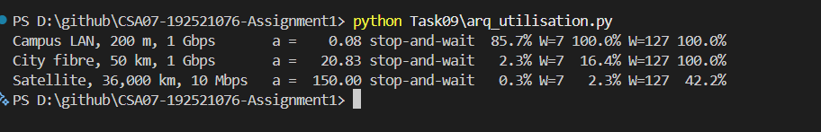

# Task 9 – How Big Must the Window Be?

## 1. Objective

To calculate transmission and propagation times, analyse Stop-and-Wait utilisation, determine the required sliding-window size, compare Go-Back-N and Selective Repeat, and understand HDLC and PPP frame boundaries.

## 2. Head-Office Link Analysis

Given:

- Distance = 400 km
- Link rate = 1 Gbps
- Frame size = 1,500 bytes
- Propagation speed = 2 × 10⁸ m/s

Calculated values:

| Parameter | Result |
|---|---:|
| Transmission time | 12 µs |
| Propagation time | 2 ms |
| Ratio a | 166.67 |
| Stop-and-Wait utilisation | 0.3% |
| Stop-and-Wait throughput | 2.99 Mbps |

Stop-and-Wait uses only a small fraction of the available 1 Gbps capacity because the sender waits for acknowledgement while the frame propagates over the long-distance link.

## 3. Sliding-Window Calculation

For full utilisation:

W ≥ 1 + 2a.

Minimum window size = **335 frames**.

Required sequence-number bits:

- Go-Back-N = **9 bits**.
- Selective Repeat = **10 bits**.

## 4. Go-Back-N vs Selective Repeat

Go-Back-N retransmits the lost frame and subsequent unacknowledged frames.

Selective Repeat retransmits only the missing frame and buffers correctly received out-of-order frames.

Selective Repeat is more bandwidth-efficient after a frame loss, but requires additional receiver memory and complexity.

## 5. HDLC and PPP Framing

HDLC and PPP use the flag sequence `01111110` to mark frame boundaries.

Bit stuffing inserts a 0 after five consecutive 1s to prevent the flag pattern from appearing accidentally within the data.

## 6. Satellite Link Analysis

For the 36,000 km satellite link at 10 Mbps:

- Transmission time = 1.2 ms.
- Propagation time = 180 ms.
- Ratio a = 150.
- Minimum window for full utilisation = **301 frames**.

## 7. Selective Repeat with Window 64

For the head-office link:

- Utilisation = **19.14% approximately**.
- Throughput = **191.4 Mbps approximately**.
- Receiver window buffer = **96,000 bytes**.

When the first frame is lost, up to 63 subsequent frames can be buffered out of order, requiring 94,500 bytes.

## 8. Python Implementation

The Python program calculates the link utilisation of Stop-and-Wait and sliding-window protocols for a campus LAN, city fibre and satellite link.

Execution command:

`python Task09\arq_utilisation.py`

### Execution Evidence

The program successfully calculated the utilisation values for all three links using window sizes of 1, 7 and 127.

## 9. Detailed Calculations

Refer to [calculations.md](calculations.md) for the complete transmission-time, propagation-time, utilisation, window-size, sequence-number and receiver-buffer calculations.

## 10. Result

The calculations demonstrate that Stop-and-Wait is inefficient over long-distance links. Sliding-window protocols improve utilisation by allowing multiple frames to be transmitted before waiting for acknowledgements. Selective Repeat reduces unnecessary retransmissions at the cost of additional receiver buffering.