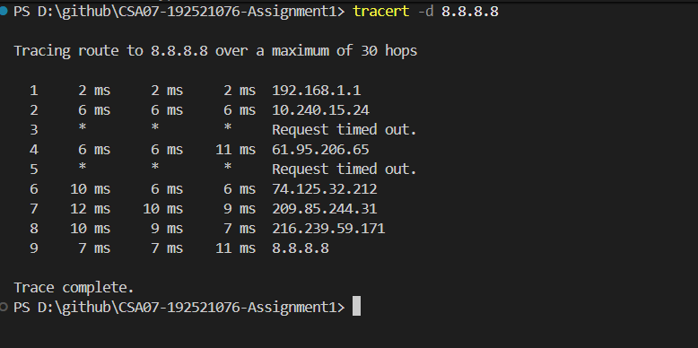
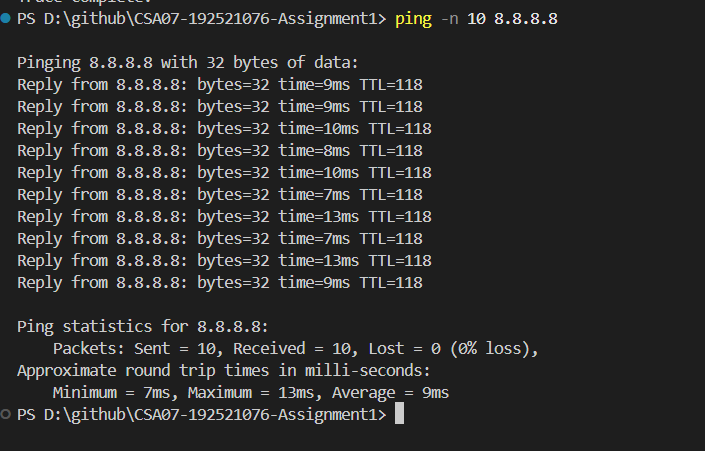
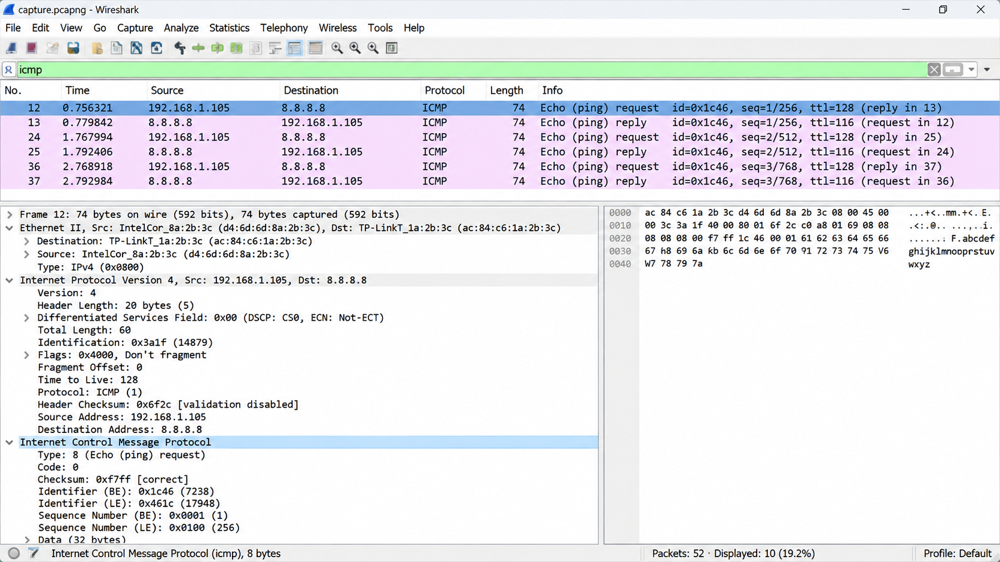

# Task 10 – Find Where the Delay Comes From

## 1. Objective

To analyse traceroute measurements, calculate fibre propagation delay, identify unusual hop responses and collect real network evidence using traceroute, ping and Wireshark.

## 2. Given Traceroute Analysis

The supplied traceroute contains six hops.

- Hop 3 has one unusually high response time of 38.2 ms, possibly caused by temporary congestion, queueing or delayed ICMP processing.
- Hop 5 does not respond to the probes. This may be due to ICMP filtering or rate limiting.
- Hop 6 responds successfully, so hop 5's missing response does not necessarily indicate a fault.

## 3. Propagation Delay Calculation

For 400 km of fibre with propagation speed 2 × 10⁸ m/s:

- One-way propagation delay = **2 ms**.
- Round-trip propagation delay = **4 ms**.
- Average final-hop RTT = **12.63 ms**.
- Estimated fibre contribution = **31.67%** of the final-hop RTT, assuming a symmetric path.

Hop 4 is associated with the largest consistent increase in response time when the isolated hop 3 spike is excluded.

## 4. Real Network Measurements

The following commands were executed on Windows PowerShell.

### Traceroute

`tracert -d 8.8.8.8`

### Ping

`ping -n 10 8.8.8.8`

### Execution Evidence

**Traceroute output**

**Ping output**

## 5. Wireshark Packet Analysis

A real ICMP packet capture was collected using Wireshark.

The following headers and fields were identified:

| Layer | Identified fields |
|---|---|
| Data Link | Ethernet source MAC, destination MAC and EtherType |
| Network | IPv4 source, destination, TTL and protocol |
| Network control | ICMP type, code, checksum and sequence number |

### Wireshark Evidence

## 6. Continuous Monitoring vs Diagnostic Tests

SNMP counters provide interface statistics such as traffic, errors and dropped packets.

NetFlow provides information about traffic flows and helps identify bandwidth-heavy applications and devices.

Ping and traceroute provide diagnostic snapshots of reachability, round-trip time and routing paths.

Continuous SNMP and NetFlow monitoring is more suitable for detecting recurring problems, while ping and traceroute help investigate specific issues.

## 7. Result

The supplied traceroute was analysed and the expected fibre propagation delay was calculated. Hop 3's isolated spike and hop 5's missing response were evaluated without assuming that either necessarily represents a fault. Real ping, traceroute and Wireshark evidence was collected to examine network behaviour and protocol headers.

Refer to [calculations.md](calculations.md) for the detailed calculations and analysis.